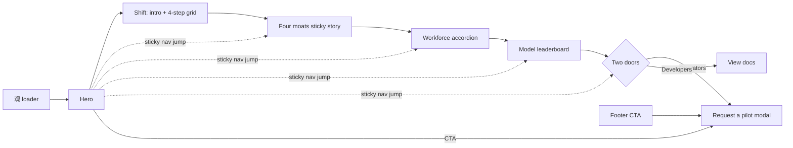

# Kairma revamp · 01 — Framework, IA, user flow

Reference: heronaiapp.com — teardown with evidence tags in
`~/projects/website-clones/heronai-clone/TEARDOWN.md`.
Mode: **content overhaul** — borrow Heron's structure, pacing and interaction grammar;
every word, image and brand decision stays Kairma's.

---

## 1 · Framework verdict — stay on Next.js 16

Heron is Webflow on the outside, but every interaction lives in a separate Vite bundle
built on plain JS libraries. None of them depend on Webflow.

| Heron uses | We have / use instead | Fit |
|---|---|---|
| GSAP 3.12 + ScrollTrigger | `gsap` 3.15 (installed) | ✅ newer |
| SplitText, TextPlugin | bundled free in `gsap` 3.13+ | ✅ |
| Lenis 1.1 smooth scroll | `lenis` 1.3 (installed), `lenis/react` | ✅ |
| Barba.js page transitions | React `<ViewTransition>` + `experimental.viewTransition` (documented in Next 16.2.7) | ✅ native |
| Swiper 11 | CSS scroll-snap, or Embla if we need drag | ✅ lighter |
| `@gsap/react` | `useGSAP` — scoped cleanup, StrictMode-safe | ✅ installed |
| Webflow CMS | typed data files / MDX | ✅ |

Why not switch (Astro, Webflow, plain Vite): we would lose the live `/api/openrouter`
route, the six-locale i18n layer, and React components — for no gain, because the
motion stack is framework-agnostic.

**Engineering rules this implies**
1. One motion engine: GSAP + Lenis. Retire `framer-motion` / `motion` (both installed) once the old sections are gone.
2. Lenis on the window, not a wrapper div — keeps ScrollTrigger, `position: sticky` and native anchors working without `scrollerProxy`.
3. Scroll stories use CSS `sticky` + a progress value (Heron does exactly this — 0 GSAP pins), not `pin: true`.
4. All motion lives in client components under `useGSAP`; server components render the static content, so the page reads fully without JS.
5. `prefers-reduced-motion` → every scrubbed/sticky story degrades to static, stacked frames.

## 2 · Skills for this project

Routed through ui-skills (max 3 per phase):

| Phase | Skills |
|---|---|
| 1 · IA + tokens (now) | `mengto/landing-page`, `ibelick/create-design-md` |
| 2 · Build | `mengto/gsap-scrolltrigger-storytelling`, `mengto/animation-systems`, `ibelick/fixing-motion-performance` |
| 3 · QA | `ibelick/fixing-accessibility`, `rams-design/rams` |

Plus the local `web-clone` method for any further Heron inspection.

## 3 · Information architecture

**Scope (decided):** the current Kairma content build stays exactly as it is — same copy, same blocks, same order, same single page.
What changes is the design language: each block takes on the Heron section pattern that fits it.

| # | Current block (content unchanged) | Heron pattern it takes on |
|---|---|---|
| 0 | 观 frontispiece boot (`guan.*`) | **Loader** — one stark image revealed by scan lines, one quiet line; once per session |
| 1 | Hero (`hero_center.*`) + locale box (`bios_locale.*`) | **Hero** — uppercase H1 bottom-left, visual centre, body + CTA bottom-right. The locale box becomes a header cell (Heron's nav is boxed cells) |
| 2 | The Shift heading/body (`shift.label/h/body`) + bulletin carousel | **Intro** — image cell (carousel, soft duotone) beside the statement, which scrubs grey → ink on scroll |
| 3 | The Shift stepper (`shift.stepper`, 4 steps) | **Problems grid** — 4 hairline cells, `[01]`–`[04]` index, line icons |
| 4 | Four Moats (`moats.*`, 4 cards + routing strip) | **Map — sticky scroll story**, the centrepiece: one stage per moat, the schematic deepening as you scroll ("ordered by depth"); the routing strip closes it as a provider-logo row |
| 5 | Workforce roster (`workforce_rail.*`) | **Use-case accordion** — one row per AI employee, with its status |
| 6 | Model leaderboard (table + pyramid) | **Platform framing** — sticky copy column beside the live UI; the table/pyramid interaction is unchanged |
| 7 | Smithy (`dev_smithy.*`) + Operators (`operators.*`) | **Two-door pair** — one cell per audience, each with its own CTA |
| 8 | Footer (`hero_left.*`, `footer.closing`, `guan.footer_line`) | **CTA + footer** — statement, Request a pilot, link columns, giant wordmark |
| — | Sticky nav (6 jump groups + Apply) | **Boxed header cells**; jump-to-section + highlight kept |
| — | Pilot / How-deployment-works / model-detail modals | Unchanged behaviour, restyled with v4 tokens |

## 4 · User flow

- **One primary action: Request a pilot** — in the hero, the nav (`Apply`), the operators door and the footer. Never two primaries in one viewport.
- Secondary: *How deployment works* (modal) and *View docs* (developers).
- Locale and theme are global chrome in the header, not content blocks.

## 5 · Design system

Configured — see `DESIGN.md` (validated: lint 0 errors, css-tailwind export emits all 5 token families) and the `DESIGN SYSTEM v4` block in `globals.css`.

Decisions recorded: hybrid corners · Inter + Noto Sans TC/JP/KR display/body, CourierPrime labels, Gloock + Canterbury reserved · both themes, light default.

Verified against Heron in the browser: at 1440px the type tokens reproduce Heron's computed sizes exactly (46.67 / 40 / 33.33 / 23.33px, gutter 16.66px, inset 6.66px, 12 columns); at 390px they match its mobile values (31.76 / 23.82 / 19.85 / 13.89px, 4 columns). Labels floor at 12px where Heron drops to 11.67px.

## 6 · Phase 2 — as built

The brief widened to a creative remodel (Heron as reference) with a copy rewrite, so the build departs from §3 in three ways:

- **Centrepiece is the Keep, not the moats.** "Data local · models cloud · only tasks route" maps one-to-one onto Heron's floor-plan story: three statements, then a schematic (the Keep's SOP engine · model router · RPA/API on one side, six model providers on the other, task routes between), then numbered hotspots, then the Key. The moats became Heron's four-cell "why" row with depth gauges.
- **Copy v7** (`src/data/site-copy-v7.ts`, all six locales): rewritten for scanning with the humanize rules: no formula contrasts, no dashes, one idea per line, every claim traced to v6. The invented v3 telemetry (moat readouts) is gone. Non-English locales need a native review.
- **Footer kept from v3** (`KairmaFooter` reveal curtain), per decision; its CTA opens the pilot form directly in v4.

Page order: 观 loader → hero → 01 shift (statement + 4-step path) → 02 the Keep (sticky story) → 03 moats → 04 workforce (accordion) → 05 models (live leaderboard) → 06/07 doors → reveal footer.
Code: `src/components/v4/*`, composed in `SiteShellV4`; `page.tsx` renders it. v3 stays in `components/layout` until sign-off.
